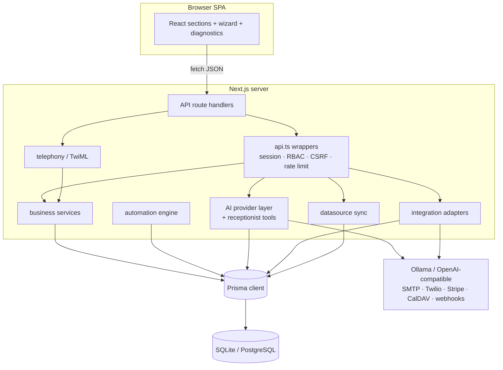
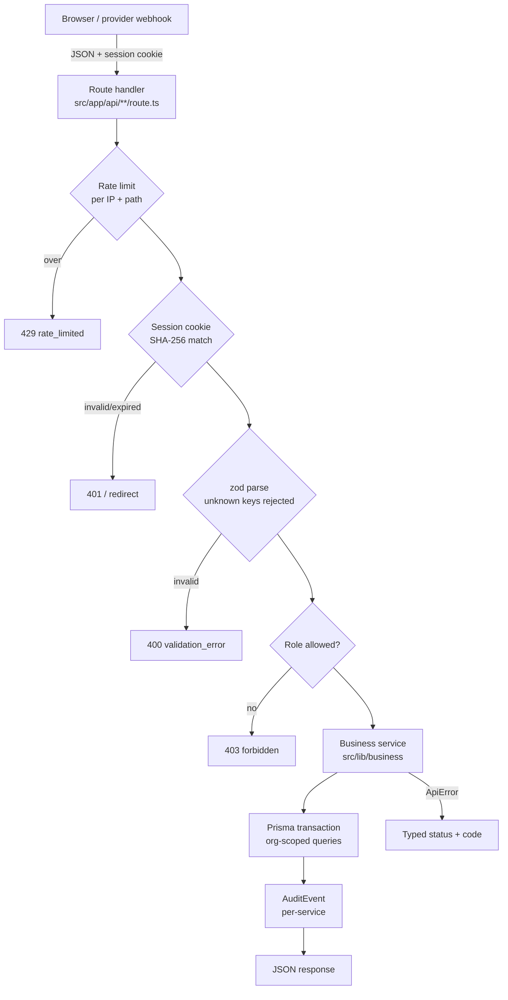
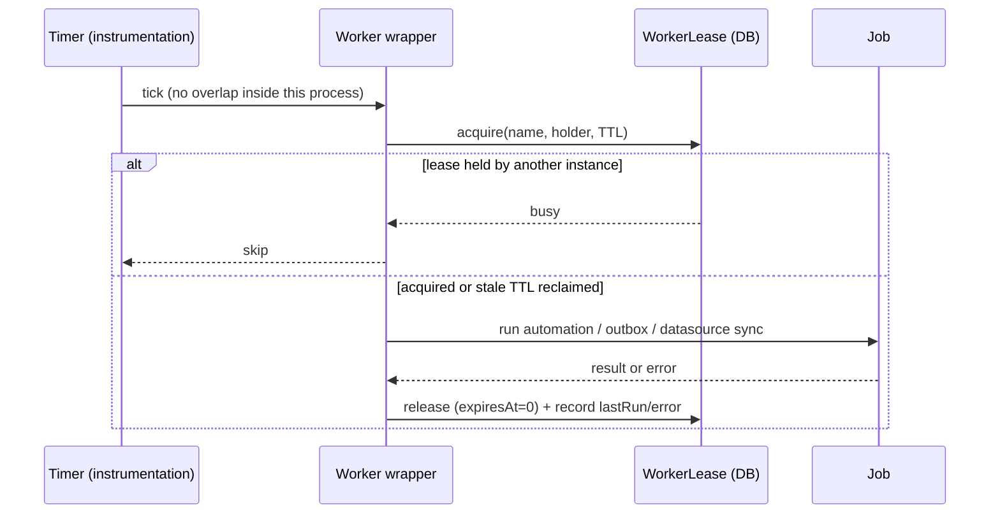
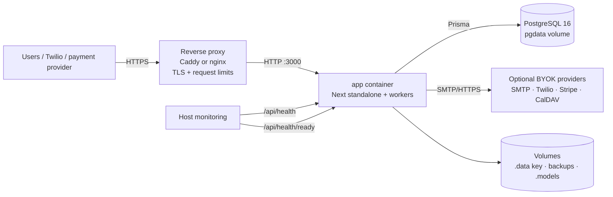

# Architecture — AI Secretary

> This document describes the architecture as built. Where a component is deferred, it is labeled
> **Deferred**/**Planned** — see [IMPLEMENTATION_PLAN.md](./IMPLEMENTATION_PLAN.md) for the live status table.

## 1. Conceptual modules → physical layout

The product is designed as four apps plus shared packages. In this build the whole thing is one
Next.js 16 App Router deployment; the conceptual boundaries map to directories:

| Conceptual module | Physical location | Responsibility |
|---|---|---|
| **apps/web** — admin dashboard + setup wizard | `src/app/page.tsx` (single-page app, client sections), `src/components/**` | Owner/admin UI: dashboard, wizard, customers, bookings, invoices, ledger, settings, Voice Console, text chat |
| **apps/api** — HTTP API | Next.js route handlers under `src/app/api/**` (no server actions) | Auth/session, RBAC, zod validation, org scoping, orchestration of business services |
| — business services (part of api boundary) | `src/lib/business/**` | Booking engine, invoice/payment math, ledger rules, customer service, automation service. Pure-ish TypeScript over Prisma; transactions live here |
| **apps/worker** — automation/outbox/data-source ticks | `src/instrumentation.ts` (`register()` starts the intervals) + manual `POST /api/automations/run`, `POST /api/outbox/dispatch` | Lease-protected periodic processing (due runs, retries, outbox delivery, due data-source sync); manual endpoints share the same leases and return 409 while a worker is running |
| **apps/voice** — voice channel | Voice Console section (`src/components/sections/voice-section.tsx`), STT/TTS lib (`src/lib/ai/speech.ts`), telephony lib (`src/lib/telephony/twiml.ts`); routes `src/app/api/ai/{asr,tts}` + `src/app/api/telephony/**` | Browser voice console (real STT/TTS) + true phone/SMS receptionist via Twilio (see §9) |
| package: db | `src/lib/db.ts` (Prisma client singleton) | Data access; schema in `prisma/schema.prisma` |
| package: ai | `src/lib/ai/**` | Provider adapters (Ollama, OpenAI-compatible), embeddings, policy gate (local_only/hybrid/cloud_first) |
| package: datasources — bring-your-own DB into RAG | `src/lib/datasources/**` (registry, adapters, sync) + routes `src/app/api/datasources/**` + UI `src/components/sections/data-sources-section.tsx` | Connect an external relational DB (postgres/mysql/sqlite) or JSON HTTP endpoint; normalize rows → `KnowledgeDoc`s → the shared chunk/embed pipeline. Read-only SQL enforcement, SSRF guard, encrypted credentials, idempotent re-sync, worker auto-sync |
| package: integrations | `src/lib/integrations/**` | SMTP/Twilio/Stripe/CalDAV adapters, outbox dispatcher, ICS feed + CalDAV push sync, generic signed-webhook adapter |



Boundary rules:

- Route handlers never touch Prisma directly for business mutations; they call `src/lib/business` services.
- Client components never import `src/lib/db`, `src/lib/ai`, or `src/lib/integrations`; those are server-only.
- The worker (instrumentation hook) reuses the same business services — no separate business logic path.
- `src/components/ui/**` is the shadcn/ui component set; app-specific components build on it and do not restyle primitives ad hoc.

## 2. Sandbox vs production delta (stated honestly)

| Concern | This build (sandbox) | Self-hosted production target |
|---|---|---|
| Runtime | Next.js dev server (`npm run dev`, port 3000; Node.js + npm — no Bun) | Docker Compose in `infra/` (app + Postgres/pgvector or single-container SQLite); both profiles built and smoke-tested on 2026-10-22 |
| Database | **SQLite** via Prisma (`file:.../db/custom.db`), WAL + 5s busy timeout | **PostgreSQL** selected by the `DATABASE_PROVIDER` build arg |
| Migrations | `prisma db push` | `prisma db push` at container start (committed migrations are future work) |
| Embeddings | JSON vectors, hybrid cosine + BM25 in-process | pgvector index is an optimization, not required to run |
| AI provider | none built-in — **BYOK only**: Ollama (local) or any OpenAI-compatible endpoint | Keys AES-256-GCM encrypted server-side, never returned |
| Rate limiting | In-memory per-process | DB/Redis-backed shared limiter is future work |
| TLS/headers termination | Security headers in `next.config.ts`; no proxy shipped | Reverse proxy (Caddy/nginx) required for TLS; headers remain app-side |

**Schema portability rules** (enforced by review, checked in [DATA_MODEL.md](./DATA_MODEL.md)):

- No Prisma `enum` types — role/status fields are `String` validated by zod unions at the boundary.
- No native `Json` columns — structured blobs are `String` columns holding JSON, parsed/validated in services.
- Money is always `Int` cents. Never floats, never decimals.
- No DB-specific types (no SQLite-only pragmas in schema, no Postgres-only column types in the shared schema).
These rules keep the SQLite→PostgreSQL switch a datasource-provider change, not a rewrite.

## 3. Request lifecycle



Auth sequencing detail: `withAuth` checks the session cookie before the zod body parse;
`withPublic` skips auth but keeps rate limiting. CSRF is enforced for authenticated
mutations (`x-requested-with: ais`). Audit writes are coupled per service, not one global
transaction around every request.



Worker lifecycle: `instrumentation.ts register()` starts three intervals (automation, outbox,
data-source sync). Each tick first acquires a DB `WorkerLease` (`runWithWorkerLease`, TTL recovery),
then claims due work: `AutomationRun` rows, queued `OutboxMessage` rows, or due `DataSource` syncs.
An in-process guard prevents overlapping ticks when a slow batch exceeds its interval; across
instances the DB lease is authoritative. Results/retries/dedupe/skips are persisted; a crashed
holder is recovered once the lease TTL lapses. Manual `POST /api/automations/run`,
`POST /api/outbox/dispatch` and datasource sync use the same leases and return
`409 worker_busy`/`sync_busy` instead of racing a scheduled or another-instance tick.

## 4. AI receptionist tool-loop design

The LLM is a **planner, never an actor**. It cannot write to the database. Every effect goes
through server-side validated tools.

```
┌────────────┐  user msg   ┌─────────────────────────────┐
│ Browser    │────────────▶│ /api/conversations/[id]/messages
│ chat/voice │             │ /api/public/chat/[slug]     │
└────────────┘             │ /api/ai/realtime/tool       │
                           │  policy gate (mode check)   │
                           │  build context (org, FAQ)   │
                           ▼                             │
                     ┌───────────┐  strict JSON tool call │
                     │ LLM via   │──────────────────────▶ tools: {name, args}
                     │ provider  │◀────────────────────── tool result JSON
                     └───────────┘   validated in route
                           │  final assistant message
                           ▼
                 Conversation + Message rows persisted (incl. every tool call)
                 (DB turn lock serializes overlapping turns for the same conversation)
```

Protocol rules:

1. **Strict JSON tool protocol.** The model must respond with either a final message or a tool
   object `{ "tool": "<name>", "args": {…} }`. Malformed JSON or unknown tool names are returned to
   the model as an error observation, not executed.
2. **Server-side validation.** Every tool has a zod schema in `src/lib/ai/tools`; args are parsed
   before execution. Invalid args produce an observation the model can recover from; they never
   partially mutate state.
3. **LLM never writes the DB directly.** Tools call the same `src/lib/business` services the UI
   uses — booking conflict rules, org scoping, and audit apply identically.
4. **Loop bounds.** Max tool iterations per turn (default 6); exceeded → graceful handoff message
   ("I'll hand this to a human").
5. **Tool categories.** Read: services/staff, availability, bookings, invoices, business info,
   FAQ search. Write: create/reschedule/cancel booking, payment claim, take-message/escalation.
   Cancellation policy is enforced by the tool; there is no invoice-void tool.
6. **Auditability.** Each tool invocation is persisted as a `Message` row (role TOOL) with args and
   result, plus `AssistantRun` metadata (provider, model, mode, latency, error).
7. **No silent fallback.** If no provider is enabled/unhealthy, the turn fails with an explicit,
   user-visible error; there is no bundled deterministic booking bot.

## 5. AI provider policies: local-only / hybrid / cloud

| Mode | Allowed providers | Enforcement |
|---|---|---|
| **local_only** | Ollama / local or private-network endpoints | Policy gate checked before every AI call; external `openai_compatible` → hard error (no silent fallback) |
| **hybrid** | Operator-configured local or cloud endpoints | Gate permits configured endpoints |
| **cloud_first** | Operator-configured cloud endpoints | Keys AES-256-GCM encrypted, server-side only |

- The mode is an org-level setting (schema/UI seed `hybrid`); changing it is audited.
- There is no managed/bundled provider and no proprietary AI SDK.
- **RAG embeddings** follow the same gate. Default is the **built-in local neural embedder**
  (`Xenova/all-MiniLM-L6-v2`, 384-d, ONNX via transformers.js, cached in `.models/`) — real
  semantic vectors with no API key and zero data egress. Alternatives: local Ollama
  (`/api/embeddings`) or an OpenAI-compatible `/embeddings` endpoint (BYOK, blocked in
  local-only mode by the policy gate). A legacy hashed keyword embedder is the last-resort
  fallback so search never breaks.
- Retrieval is **hybrid**: dense cosine (only when chunk.model === active model) fused with
  BM25 lexical scoring (72/28). Chunks store their embedding model + dimension, so switching
  models marks the index stale (`needsReindex`) and `POST /api/knowledge/reindex` re-embeds
  under the new model with an audited, observable run. The embedding model is pre-warmed at
  server boot (`instrumentation.ts`) so the first search is fast.
- On PostgreSQL production, chunk vectors should move to **pgvector**; the JSON-vector layout
  (SQLite build) is documented as the portable intermediate representation.
- Provider connection tests (`POST /api/providers/[capability]/test`) store honest
  `lastTestOk/lastTestError`; the assistant surfaces a clear error when no enabled provider is
  available rather than silently pretending to answer.

## 6. Automation engine

Model: **trigger → (conditions) → (delay) → actions**, executed by the worker tick.

| Aspect | Design |
|---|---|
| Triggers | `invoice_overdue`, `booking_created`, `booking_reminder`, `conversation_escalated`, `manual` |
| Conditions | Field predicates (e.g. status, balance/outstanding, consent), AND-composed |
| Delay | `delayMinutes` between trigger and execution; the run is persisted with `scheduledFor`, so restarts don't lose it |
| Actions | `send_invoice_reminder`, direct `send_email` / `send_sms` / `send_webhook`, `notify_inapp`, `flag_for_review` |
| Retry | Exponential backoff with attempt tracking; `lastError` recorded per run |
| Test mode | Logs what would be queued/sent instead of sending |
| Worker | 60 s lease-protected tick; manual run shares the lease |
| Dedupe | `dedupeKey` (rule, subject, calendar window) unique — prevents duplicate reminders for the same booking/invoice |
| Audit | Every run persisted (`AutomationRun`) with status QUEUED/RAN/SKIPPED/FAILED/CANCELLED + error; skipped-by-dedupe and skipped-by-opt-out are explicit statuses, not silent drops |

Consent & opt-out are checked at run time, not just creation time: a customer with a channel opt-out
makes the action SKIPPED with reason OPTED_OUT (see [SECURITY.md](./SECURITY.md) §Consent).

## 7. Data & money rules (summary)

- Every business row carries `organizationId`; queries are always org-scoped (see
  [DATA_MODEL.md](./DATA_MODEL.md) invariants).
- Money: `Int` cents; balances are computed from verified payments only.
- Ledger is append-only; corrections are adjustment/reversal entries that reference the original.
- Multi-step writes (booking insert + conflict check; payment + invoice status; ledger entries) run
  inside Prisma interactive transactions.

## 8. Observability & operations

- `dev.log`/container stdout captures server output; API failures are logged server-side and
  returned as typed errors (no stack traces to clients).
- `GET /api/health` is a pure liveness probe (no DB access).
- `GET /api/health/ready` performs a real `SELECT 1` and returns `503` when the database is
  unreachable; Docker/compose uses it as the readiness healthcheck.
- `GET /api/health/detail` (authenticated) reports DB tuning, worker leases, provider state,
  heartbeat and counts for operators.
- Audit trail (`AuditEvent`) is the primary "what happened" record; dashboard ledger view is the
  financial record.
- Backups: `POST /api/admin/backup` runs SQLite `VACUUM INTO`; `GET /api/admin/export` produces a
  secrets-free JSON snapshot. On Postgres use `pg_dump` (the in-app backup endpoint is SQLite-only).
- Diagnostics: `/api/health/detail` reports DB round-trip/tuning, worker leases, heartbeat, provider
  state and org counts; no scheduled backup script is shipped.
- Container operations: log rotation, `init`, stop grace period and a readiness healthcheck are
  configured in the Docker packaging.

## 9. Voice, telephony & calendar sync

Three voice surfaces share ONE receptionist brain (`handleReceptionistTurn` — the same validated
tools, audit trail, and data-mode policy gate as text chat):

| Surface | Speech path | Auth |
|---|---|---|
| **Voice Console** (browser, `#voice` section) | Browser records audio → `POST /api/ai/asr` (real STT: OpenAI-compatible `/audio/transcriptions`, or the device's own Web Speech API) → receptionist turn → `POST /api/ai/tts` (real TTS: OpenAI-compatible MP3; text chunked ≤ 1000 chars) → browser playback. Per-turn STT/AI/TTS latency badges. | Session cookie (CSRF-protected) |
| **Phone** (Twilio Voice) | Twilio does the speech recognition (`<Gather input="speech">`); the app runs the full turn and answers with TwiML `<Say>`; escalation → `<Dial>` transfer or message-taken hangup; status callbacks close the call. | Twilio signature |
| **SMS** (Twilio) | Webhook threads one conversation per sender number, records the inbound message instantly, answers asynchronously via the Twilio Messages API; send failures land in the outbox with honest status + retry/backoff. | Twilio signature |

**Transcripts.** The dialogue lives in `Conversation` + `Message` rows exactly like web chat
(customer/assistant/tool messages; `Conversation.externalRef` carries the telephony thread key —
CallSid for calls, `sms:{digits}` for SMS threads). **No audio is persisted anywhere**: STT audio
is decoded, transcribed, and dropped; TTS audio is returned as base64 for playback and never
stored; on phone calls the media never touches this server at all (Twilio's own `<Say>/<Gather>`
handle speech). Inbound SMS bodies are additionally captured verbatim in `WebhookEvent` payloads.

**Calendar sync — two-way design.** `src/lib/integrations/caldav.ts` is a raw-HTTP CalDAV client:
`PROPFIND` health check (207/200), `PUT {uid}.ics` idempotent upsert, `DELETE`; HTTP Basic auth;
a real RFC 5545 VEVENT builder (line folding, escaping, UTC stamps, `X-AIS-ORG` org marker).
`POST /api/integrations/caldav-sync` (owner/admin, "Sync now") pushes upcoming `pending|confirmed`
bookings (default 45 days) and pulls previously pushed events: remote `STATUS:CANCELLED` cancels
the booking, a moved `DTSTART` reschedules through the validated booking service, and remote
deletes are reported as `missing` rather than auto-cancelled. Per-item results and a persisted
last-sync summary are returned; verified against Radicale.

**Google Calendar sync.** `src/lib/integrations/googleCalendar.ts` speaks the Google Calendar v3
API directly (fixed Google endpoints — no user-controlled host, so no SSRF surface). OAuth 2.0
authorization-code flow: the authorize route mints a one-time nonce stored in `AppSetting`, Google
calls back with a code, the code is exchanged for access + refresh tokens and the refresh token is
stored encrypted in `Integration.secretsEnc`. Access tokens are refreshed on demand.
`POST /api/integrations/google-calendar/sync` then does three things: free/busy windows become
`CalendarBlock` rows (external busy time is subtracted from availability and from the booking
transaction), our own pushed bookings are excluded from those blocks, and bookings are pushed as
Google events marked with a private `aisBookingId` extended property (idempotent re-push).
Remote cancellations and moves are pulled back through the validated booking service.

**Blocked periods.** `CalendarBlock` is the single representation of "you cannot be booked"
(external busy windows and manual blocks). `computeSlots` subtracts them from every slot list and
`assertSlotAvailable` rejects an overlapping booking inside the booking transaction
(`409 slot_blocked`). The assistant can create blocks with the `block_time` tool; staff manage them
through `/api/calendar/blocks`.

**Receptionist runtime switch.** `Organization.receptionistStatus` is `running | paused | stopped`.
It is enforced at the edges: the inbound SMS/WhatsApp webhooks, the voice incoming route (calls
routed to a human agent line are exempt), the speech gather loop, the public web chat, the realtime
session mint and the receptionist turn runner itself. `paused` records inbound for staff without
answering; `stopped` acknowledges webhooks, audits a short preview and opens no conversation at
all. Changes go through `PATCH /api/settings/receptionist` (owner/admin) and are audited.

**PABX routing (phone lines).** `src/lib/telephony/routing.ts` contains pure helpers used by the
voice incoming route: `least_busy` (real active-call load), `round_robin` (CAS-updated cursor in
the line config), and `redirect` (deterministic priority target). Disabled or `acceptingCalls:false`
lines are excluded; lines without a `TelephonyLine` row remain eligible with zero load. Every call
creates a `TelephonyCall` row; status callbacks prefer Twilio `DialCallStatus` for `<Dial>` results
and normalize `ringing/queued → started`, `in-progress → answered`, `no-answer/busy/canceled → missed`.
No-input counters are shared between gather and status so completed calls clear their state.

## 10. Production deployment topology



Operational invariants:

- Terminate TLS at the proxy; never publish the app port directly on the public internet.
- The app writes only to its database and mounted `app_data`/`app_backups`/`app_models` volumes.
- `APP_SECRET` (or the generated `.data/secret.key`) must be backed up with the database; without it,
  encrypted provider/integration credentials are unrecoverable.
- Schema boot applies only additive changes. Destructive changes fail the boot and require an
  explicit operator migration after a backup.
- Run SQLite with exactly one app container. Use PostgreSQL for multiple replicas; workers are
  lease-protected, but only one instance needs to run them (`AIS_DISABLE_WORKERS=1` elsewhere).
