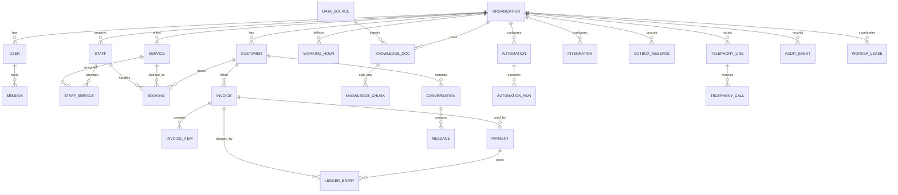

# Data Model — AI Secretary

Source of truth: `prisma/schema.prisma` (**30 models**). This document is a field-level reference for
the operational tables plus the invariants the service layer enforces.

Portability rules (SQLite → PostgreSQL): no Prisma enums (string columns + zod unions), no native
`Json` columns (JSON in `String` columns), money is `Int` cents, no DB-specific column types.

Conventions: IDs are `String @id @default(cuid())`; business tables carry `orgId`; timestamps are
`createdAt`/`updatedAt` unless noted; `*Json`/JSON columns are strings validated by zod on read/write.

## 1. Model index

| Model | Purpose |
|---|---|
| `Organization` | Tenant root: business profile, timezone, locale, currency, hours, policies, AI identity, setup state, data mode. |
| `User` | Login identity; unique `email`, scrypt `passwordHash`, `role` (`owner|admin|agent|viewer`),
  encrypted TOTP secret, `active`, `twoFactorLastCounter`, `lastLoginAt`. |
| `Session` | Hashed session token, expiry, `revokedAt`. |
| `AppSetting` | Org key/value JSON (webhook secret, wizard state, channels, CalDAV sync summary, `notification_routing`, `receptionist_schedule`, `backup_schedule`). |
| `WorkerLease` | Single-flight lease for automation/outbox/data-source workers (TTL recovery). |
| `Customer` | End customer: contact, tags, `consentContact`, absolute `optOut`, per-channel `commPrefs`, external ref. |
| `Service` | Bookable service: duration, buffers, capacity, price/deposit cents, active. |
| `Staff` | Staff/practitioner/crew member. |
| `StaffService` | Staff ↔ service join (`@@id([staffId, serviceId])`). |
| `WorkingHour` | Per-staff or org-wide (`staffId:null`) weekly hours by `dow` + minute offsets. |
| `Booking` | Reservation with `startAt/endAt`, status, source, price snapshot. |
| `CalendarBlock` | A period that cannot be booked: external busy time (`source: google_calendar`) or a manual block. Read by the availability engine and the booking transaction. |
| `Invoice` | Invoice header: number, status, subtotal/tax/total/paid cents, issue/due dates. |
| `InvoiceItem` | Invoice line: description, qty, unit/total cents. |
| `Payment` | Payment record with method, status, idempotency/external-event keys. |
| `LedgerEntry` | Append-only double-entry row (debit/credit accounts, reversal pointer). |
| `WebhookEvent` | Inbound webhook dedupe/audit row (provider, unique event id, signature result). |
| `KnowledgeDoc` | Knowledge/FAQ document; approved-only retrieval; data-source link + content hash. |
| `DataSource` | BYO external DB/JSON source: encrypted connection, query config, sync status/counts. |
| `KnowledgeChunk` | Chunk text + JSON vector + model/dimension for hybrid retrieval. |
| `Conversation` | Channel thread (web/sms/whatsapp/phone/realtime/voice_test), status, AI toggle, turn-lock fields. |
| `Message` | Conversation message; roles `customer/assistant/agent/system`; tool metadata in JSON. |
| `OutboxMessage` | Outbound email/SMS/WhatsApp/webhook/in-app row with attempts + honest status. |
| `ProviderConfig` | AI capability row; encrypted API key; enabled/test state. |
| `AiLog` | Metrics-only AI call log (capability/provider/model/latency/tokens/error). |
| `Automation` | Rule: trigger, conditions, delay, actions, quiet hours, caps, test mode. |
| `AutomationRun` | Per-run status/attempts/input/output/error + dedupe key. |
| `Integration` | Third-party channel row; non-secret config JSON + encrypted secrets. |
| `TelephonyLine` | PABX agent line: number, priority, enabled, `acceptingCalls`, destination. |
| `TelephonyCall` | Call record: CallSid, from/to, line, normalized status, duration, metadata. |
| `AuditEvent` | Append-only audit trail (actor, action, entity, metadata). |

## 2. Relationships

All business tables carry `orgId`; every query filters it. `User.orgId` is the membership link — there
is no separate Membership model (one user belongs to one organization in this build).

Financial relationships are append-only: `LEDGER_ENTRY` rows reference an invoice/payment and can point
at a reversal row; they are never updated or deleted.

## 3. Key tables

### Organization
`name`, unique `slug`, `businessType` (`apartment_rental|car_rental|salon|clinic|contractor|generic`),
`timezone`, `locale`, `currency`, `address/phone/email`, JSON `openingHours`/`holidays`/`policies`/
`aiIdentity`/`collectionsCfg`, `demo`, `setupState`, `setupComplete`, `dataMode`
(`local_only|hybrid|cloud_first`).

### User / Session
- `User`: unique `email`, scrypt `passwordHash`, `role` (`owner|admin|agent|viewer`), encrypted
  `twoFactorSecret`, `twoFactorEnabled`.
- `Session`: unique `tokenHash` (SHA-256 of the cookie token), `expiresAt`, nullable `revokedAt`.

### Customer
`name`, `email`, `phone`, notes, JSON `tags`, `consentContact` (service communications),
`optOut` (absolute outbound block), JSON `commPrefs` (per-channel opt-ins for service, booking,
invoice, reminder and marketing messages; marketing defaults off), `externalRef`.

### Service / Staff / WorkingHour
- `Service`: `durationMin`, `bufferBeforeMin`/`bufferAfterMin`, `maxPerSlot`,
  `requiresDeposit`/`depositCents`, `priceCents`, `currency`, `active`.
- `Staff`: role/contact/active; `StaffService` joins skills.
- `WorkingHour`: `staffId?`, `dow` 0=Sun, `startMin`/`endMin`; org-wide rows use `staffId:null`.

### Booking
`customerId`, `serviceId`, `staffId?`, `startAt`/`endAt`, `status`
(`pending|confirmed|cancelled|completed|no_show`), `source` (`manual|ai_chat|ai_voice|web|import`),
`priceCents` snapshot, `cancelReason`. No `resourceId` exists in the current schema; capacity is
modeled by `Service.maxPerSlot` and working hours.

### Invoice / InvoiceItem / Payment
- `Invoice`: org-unique `number`, status (`draft|sent|partial|paid|void|uncollectible`), `currency`,
  subtotal/tax/total/paid cents, `issueDate`/`dueDate`, JSON-ish `rentalPeriod`.
- `InvoiceItem`: qty/unit price/total cents.
- `Payment`: `amountCents`, `method` (`manual|card|bank|cash|online`), `status`
  (`pending_verification|verified|failed|refunded`), `source` (`manual|webhook|customer_claim`),
  globally unique nullable `idempotencyKey` and `externalEventId`, `verifiedAt/verifiedBy`.
  Only `verified` payments affect balances.

### LedgerEntry
`ts`, `type` (`charge|payment|refund|adjustment|reversal`), `debitAccount`, `creditAccount`,
`amountCents`, optional `invoiceId`/`paymentId`/`bookingId`, `memo`, `reversalOfId`, `createdBy`.
Append-only by code; corrections reference the original row.

### WebhookEvent
`provider`, globally unique `eventId`, raw `payload`, `signatureValid`, `result`
(`received|processed|duplicate|rejected`), `processedAt`.

### KnowledgeDoc / DataSource / KnowledgeChunk
- `KnowledgeDoc`: `title`, `source` (`manual|paste|file|datasource`), `content`, `approved`,
  `tags`, optional `dataSourceId`, `externalId`, `contentHash`; unique `(dataSourceId, externalId)`.
- `DataSource`: `kind` (`sqlite|postgres|mysql|http_json`), encrypted `connectionEnc`, JSON
  `configJson`, `enabled`, `autoSync`, `syncIntervalMin`, last test/sync state, doc/chunk counts.
- `KnowledgeChunk`: `docId`, `ord`, `text`, JSON `vector`, `model`, `dim`; dense cosine only when
  model+dim match the active embedding model.

### Conversation / Message
- `Conversation`: `channel`, `status` (`open|waiting_human|closed`), `aiEnabled`, `summary`,
  `contactName`, `externalRef` (CallSid or `sms:{digits}` / `whatsapp:{digits}`),
  `turnLockToken` + `turnLockedAt` for per-thread serialization, `customerId?`.
- `Message`: role `customer|assistant|agent|system`, `content`, JSON `meta` (toolCalls/usage/provider).
  Tool calls/results live in `meta`, not a separate TOOL role.

### OutboxMessage
`channel` (`email|sms|whatsapp|webhook|inapp`), `recipient`, `subject`, `body`, optional `html`,
`status` (`queued|sent|failed|skipped`), `statusReason`, `attempts`, `relatedType/relatedId`,
unique nullable `dedupeKey`, `scheduledFor`, `sentAt`. Delivery receipts: `providerKind`,
`providerMessageId`, `deliveryStatus` (`accepted|delivered|read|failed`), `deliveryDetail`,
`deliveryUpdatedAt`; indexed by `(orgId, providerKind, providerMessageId)`. `sent` means provider
acceptance — only a later DLR callback sets `delivered`/`read`/`failed` (states never regress).

### ProviderConfig
`capability` (`llm|embedding|stt|tts|realtime|rerank|vision`), `provider`
(`ollama|openai_compatible|browser|local_neural|local_lexical|none`), base URL/model, encrypted
`apiKeyEnc`, JSON config, `enabled`, last test state; unique `(orgId, capability)`.

### Automation / AutomationRun
- `Automation`: `triggerType` (`invoice_overdue|booking_created|booking_reminder|
  conversation_escalated|manual`), JSON `triggerCfg`/`conditions`/`actions`, `delayMinutes`,
  `maxRunsPerDay`, JSON `quietHours`, `testMode`, `enabled`.
- `AutomationRun`: `status` (`running|success|failed|skipped`), `attempt`, `dedupeKey`,
  input/output/error JSON, `scheduledFor`/`startedAt`/`finishedAt`; unique `(automationId, dedupeKey)`.

### Integration
`kind` (`smtp|email_api|twilio_sms|twilio_whatsapp|meta_whatsapp|twilio_voice|sms_gateway|caldav|google_calendar|microsoft_calendar|stripe|square|quickbooks|xero|myob|shopify|woocommerce|wix|mailchimp|webhook_out|imap`),
non-secret `configJson`, encrypted `secretsEnc`, `enabled`, last test state. Singleton kinds are
enforced in code; `webhook_out` allows multiple destinations.

### CalendarBlock

`CalendarBlock` is the single representation of "you cannot be booked". `source` distinguishes the
origin: `manual` (staff blocks, created by `/api/calendar/blocks` or the `block_time` tool),
`google_calendar` (free/busy windows pulled from Google), `microsoft_calendar` (free/busy windows
pulled from Microsoft 365) and `caldav` (events read back from a CalDAV collection). `externalId`
makes the sync idempotent — the same external event is updated, not duplicated. Both
`computeSlots` and the booking transaction honour these rows.

### WorkerLease
`name` (PK), `holder`, `expiresAt`, `lastRunAt`, `lastError`, `updatedAt`. Expired leases are
recoverable; a completed worker moves `expiresAt` into the past.

### Invite / PasswordResetToken / RateBucket
- `Invite`: pending join invitation; `email`, `role`, `tokenHash` (`@unique`), `invitedById`, `expiresAt` (7 days), `acceptedAt`/`revokedAt`. The plain token is returned once (invite URL + the inviter's copy) and only its hash is stored.
- `PasswordResetToken`: one-time reset tokens for a user; `userId`, `tokenHash` (`@unique`), `expiresAt` (1 hour), `usedAt` (set on successful reset).
- `RateBucket`: shared-store rate limit counters; `key` (`@unique`), `count`, `windowStart`, `expiresAt` — the login limiter survives restarts and is shared between replicas.

### TelephonyLine / TelephonyCall
- `TelephonyLine`: `integrationId`, `label`, `phoneNumber`, destination kind/value, `priority`,
  `enabled`, `acceptingCalls`.
- `TelephonyCall`: `callSid`, from/to, `lineId`, `status`
  (`started|answered|completed|failed|missed|no_answer`), `startedAt`/`endedAt`, `durationSec`,
  JSON `meta`. Status normalization lives in `src/lib/telephony/routing.ts`.

### AuditEvent
`ts`, `actorType` (`user|ai|system|webhook`), `actorId`, `action`, `entity`, `entityId`, JSON `meta`.
Append-only; never user-editable.

## 4. Invariants

| # | Invariant | Where enforced |
|---|---|---|
| 1 | **Booking conflict protection.** Overlaps for the same staff/service capacity are rejected (409); check-and-insert runs in a transaction. SQLite serializes writers; Postgres relies on the transaction boundary (exclusion index is future hardening). | `src/lib/business/booking*` |
| 2 | **Invoice balance.** `paidCents` is the verified-payment sum; status transitions derive from verified payments only. | `src/lib/business/payments` |
| 3 | **Ledger corrections.** No update/delete paths; corrections are `adjustment`/`reversal` rows referencing `reversalOfId`. | `src/lib/business/ledger` |
| 4 | **Payment idempotency.** Unique `idempotencyKey` and `externalEventId`; duplicate webhooks return the original result and never double-post. | `src/lib/business/payments` |
| 5 | **Org scoping.** Every business query filters `orgId` from the session; cross-org IDs return 404. | routes + services |
| 6 | **Money is integer cents.** No floats in write paths. | schema + zod |
| 7 | **Only verified payments count.** Pending claims/inbound events never change balances. | payments |
| 8 | **Consent gating.** `optOut` or `consentContact=false` blocks outbound SMS/WhatsApp/email; inbound is still stored. | collections/dispatcher/telephony |
| 9 | **Conversation serialization.** A DB token lock with stale TTL prevents overlapping turns; busy requests fail with `conversation_busy`. | `src/lib/concurrency.ts` + receptionist |
| 10 | **Worker single-flight.** Automation/outbox/data-source workers and manual runs share leases; crashed holders recover after TTL. | `WorkerLease` + `runWithWorkerLease` |
| 11 | **Wizard state survives restarts.** Persisted in `Organization.setupState`; completion is explicit. | setup routes |
| 12 | **Audit after mutation.** Consequential mutations write `AuditEvent`; audit is append-only (usually after the write, not always one transaction). | services/routes |
